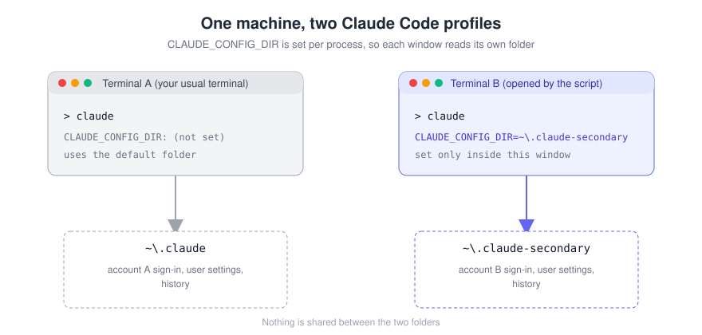
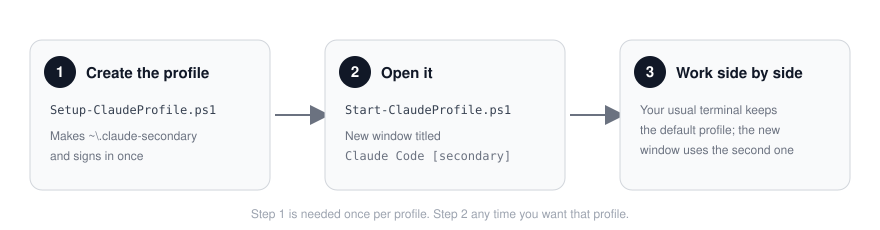

# Claude Dual-CLI（Windows）

[](LICENSE)


[English](README.md) | **繁體中文**

在同一台 Windows 電腦上並排開兩個 Claude Code CLI，各自登入自己的帳號、各自保留設定與對話紀錄。

常見用途：

- 同一台電腦上把**工作**和**個人**帳號分開
- 兩件平行的工作（例如前端、後端）各用**獨立的上下文與設定**
- 想試新設定或新的 MCP server，先開一個**拋棄式設定檔**，不動到主要環境

> **請先看：** 只使用你自己擁有的帳號，並遵守 [Anthropic 的服務條款與使用政策](https://www.anthropic.com/legal)。本專案只負責把兩組設定分開，不會改變任何帳號的使用額度。



## 運作原理

Claude Code 把登入資訊、設定和對話紀錄存在一個設定資料夾裡，環境變數 `CLAUDE_CONFIG_DIR` 決定要用哪一個資料夾。

本專案的腳本**只在新開的 PowerShell 視窗裡**設定這個變數，你平常用的終端機不受影響，照樣使用預設帳號。

## 需求

- Windows 10 或 11
- Windows PowerShell 5.1 或 PowerShell 7 以上
- 已安裝 [Claude Code](https://docs.anthropic.com/en/docs/claude-code)，且終端機打得到 `claude`
- 第二個可以登入的帳號

## 快速開始



```powershell
git clone https://github.com/sss40914/Claude-Dual-CLI.git
cd Claude-Dual-CLI

# 如果系統擋住腳本執行，只對這個視窗放行：
Set-ExecutionPolicy -Scope Process -ExecutionPolicy Bypass

# 1. 建立第二組設定並登入（只要做一次）
.\scripts\Setup-ClaudeProfile.ps1

# 2. 用第二組設定開一個新視窗
.\scripts\Start-ClaudeProfile.ps1
```

平常的終端機照樣打 `claude`，用的是預設帳號。

## 腳本說明

### `Setup-ClaudeProfile.ps1`

| 參數 | 預設值 | 說明 |
|---|---|---|
| `-Name` | `secondary` | 設定檔名稱，資料夾會是 `%USERPROFILE%\.claude-<Name>` |

建立資料夾，用這個資料夾執行 `claude auth login`，最後印出 `claude auth status`，讓你確認登入的是哪個帳號。

### `Start-ClaudeProfile.ps1`

| 參數 | 預設值 | 說明 |
|---|---|---|
| `-Name` | `secondary` | 要開哪一組設定 |
| `-ProjectPath` | 目前資料夾 | 在哪個專案資料夾開 Claude Code |
| `-SameWindow` | 關 | 在目前視窗執行，不另開新視窗 |
| `-DryRun` | 關 | 只印出會執行的內容，不實際啟動 |

新視窗標題是 `Claude Code [<Name>]`，一眼分得出是哪一組。

## 範例

```powershell
# 建一組 "work" 設定，直接開在指定專案
.\scripts\Setup-ClaudeProfile.ps1 -Name work
.\scripts\Start-ClaudeProfile.ps1 -Name work -ProjectPath D:\code\api

# 查某組設定登入的是哪個帳號
$env:CLAUDE_CONFIG_DIR = "$HOME\.claude-work"; claude auth status; Remove-Item Env:CLAUDE_CONFIG_DIR
```

更多用法（包含 Windows Terminal 設定檔）在 [`examples/`](examples/)。

## 注意事項

- **每組設定各自保存使用者層級的資料**：登入、使用者設定、使用者層級的 MCP server、對話紀錄都不共用，需要的使用者設定請自己複製到新資料夾。放在專案裡的檔案（例如 `CLAUDE.md`、`.claude/settings.json`、`.mcp.json`）仍然共用，因為兩個視窗開的是同一個專案。
- **從 Claude Code 裡面啟動**：如果你是在 Claude Code 自己開的終端機裡跑腳本，那個終端機帶著工作階段的環境變數。腳本會偵測到並在新視窗清掉，讓新的工作階段乾淨開始。
- **移除設定檔**：先用該設定登出（`claude auth logout`），再刪掉 `.claude-<Name>` 資料夾。
- **資料夾要保密**：裡面有登入資料，不要上傳或分享；本專案的 `.gitignore` 已排除 `.claude*/`。

## 疑難排解

請看 [docs/troubleshooting.zh-TW.md](docs/troubleshooting.zh-TW.md)。

## 參與貢獻

歡迎開 issue 或 PR。回報時請附上 Windows 與 PowerShell 版本，**不要貼出 token 或設定資料夾裡的內容**。

## 授權

[MIT](LICENSE)
